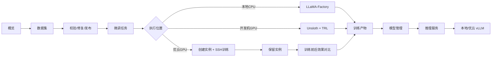

# 老师要求确认版与后续规划

更新时间：2026-08-24

本文档记录老师要求与当前对话确认后的范围，作为后续并行开发对话的共同上下文。

## 1. 已确认范围

### 本阶段要做

- 概览页：以系统运行指标为主，补充训练、推理和远程 GPU 的关键状态。
- 梳理项目主流程，用 Mermaid 表达，并用小白能理解的方式说明每一步对应的代码、接口、参数、技术和失败兜底。
- 重点理解 Agent/RAG 的设计思路、提问角度和排查问题的方法；本阶段不实现 Agent/RAG。
- 详细梳理本地 CPU、开发机 GPU、优云 GPU 训练流程及参数文件。
- 推理服务增加远程 GPU 管理的架构预留，优先跑通优云适配。
- 训练、模型加载、效果对比等耗时过程按需要增加进度显示。
- 支持模块内部的多级菜单，但一级模块固定为：概览、数据集、微调任务、模型管理、推理服务。
- 推理服务的上下文长度和最大输出根据基模型能力动态设置，不再只依赖固定默认值。
- 优云训练完成后不立即释放 GPU：先保留实例，执行训练前后效果对比，再由人工选择“任务结束并释放资源”或继续调试。
- 数据集校验失败后只提供人工编辑；错误详情可点击定位到对应行，系统不自动改写 role、文本或空行。
- 以教程和问答形式解释 vLLM、Unsloth、训练、推理和数据流，面向小白用户。

### 本阶段不做

- 不实现 Agent 编排器、工具调用循环、RAG 检索器、向量库和 Embedding 服务。
- 不接管同事负责的 RAG 实现，只需要读懂其接口和提问方式。
- 不做公网推理、API Key 正式分配、用户鉴权和收费计费。
- 不实现数学、语言、推理等专业模型评测模块；本阶段只做技术调研和后续预留。
- 不扩展一级模块，不新增视觉微调、BERT 编解码器等独立一级菜单。

## 2. 当前项目与目标的关键差距

1. 当前已有本地 vLLM 推理和 SSE 流式代理，但这不是 Agent 流程。
2. 当前已有优云训练执行器，但训练结束后的默认清理策略与“人工确认后释放”冲突。
3. 当前推理服务存在固定的上下文长度和最大输出默认值，尚未读取基模能力并做联动校验。
4. 当前概览主要是数据集数量统计，尚未形成系统级运行监控。
5. 当前训练参数模型、LLaMA-Factory 配置转换和优云参数已经存在，但缺少完整的可读说明。
6. 当前数据集有校验失败状态和错误提示，需要完善“错误定位 -> 手动编辑 -> 预览 -> 重新校验 -> 发布”闭环。
7. 当前左侧导航是普通布局，左下角仍显示“平台管理员”，需要调整为固定侧栏和中心滚动。
8. 当前产物主要按任务 ID 和目录保存，需要增加带日期的权重显示名或产物名，例如 `qwen3-sft-2026-08-24`。

## 3. 主流程说明

## 4. Agent/RAG 只读懂、不实现时要掌握的问题

后续阅读同事代码或老师截图时，重点围绕这些问题提问：

- 用户问题进入哪个 API？
- 哪一层判断是否需要知识库？
- 什么时候调用 Embedding？
- 什么时候检索，召回几条，如何过滤？
- 什么时候把检索结果拼进大模型请求？
- Agent 是否允许调用工具？工具有哪些？
- 工具参数从哪里生成，如何校验？
- 大模型响应是一次性返回还是 SSE 流式返回？
- 流式过程中如何处理半截 JSON、异常和断线？
- 检索为空、模型失败、工具失败时分别如何兜底？
- 请求、响应、Token、耗时和错误如何记录？

这些问题用于理解和排查，不代表本阶段要在本项目中新增 Agent/RAG 代码。

## 5. 分阶段实施顺序

### 阶段一：需求固化和流程文档

- 形成系统总流程、训练流程、推理流程、优云流程 Mermaid 图。
- 为每一步标出前端文件、后端文件、API、主要参数、状态和失败处理。
- 单独整理 vLLM、Unsloth、LLaMA-Factory 的职责边界。

### 阶段二：概览和页面骨架

- 概览先展示系统健康、训练队列、推理服务、GPU/CPU/内存、失败任务和最近活动。
- 固定左侧导航，仅中心内容滚动。
- 移除左下角平台管理员展示。
- 为四个业务模块预留二级菜单容器，但第一批不扩展一级模块。

### 阶段三：训练和优云生命周期

- 梳理每个训练参数的含义、默认值、取值范围和实际传递位置。
- 优云训练完成后保留实例。
- 自动执行训练前后对比。
- 对比页显示 Base、Best、Final 的输入、输出和指标。
- 提供人工按钮：继续调试、结束任务并释放资源、销毁实例。
- 失败、停止、超时仍需有明确清理策略和异常记录。

### 阶段四：推理服务能力适配

- 读取基模配置中的最大上下文长度。
- 根据上下文长度限制最大输出 Token。
- 为本地和优云推理统一 Provider 接口。
- 先完成优云推理流程，公网暴露和计费留到后续阶段。

### 阶段五：数据集与可视化体验

- 校验失败记录具体行、字段和原因。
- 错误详情点击后定位到对应 JSONL 行。
- 只允许手动编辑、预览、重新校验和版本记录，不自动修改用户数据。
- 为模型下载、训练、评测和对比补充真实进度状态。

## 6. 后续并行对话拆分

需求确认后可以并行开以下对话：

1. 概览监控与固定侧栏。
2. Mermaid 流程文档与小白教程。
3. 优云训练保留实例、训练对比和释放流程。
4. 推理服务动态上下文与优云适配。
5. 数据集错误定位、手动编辑、重新校验和进度条。

所有对话都必须遵守本文档的“本阶段不做”范围。

## 7. 验收原则

- 先能看懂，再改代码；每次改动都说明影响了哪条业务流程。
- 页面上的状态必须来自真实 API，不用静态假数据冒充运行状态。
- 优云资源释放必须由明确的人为操作触发，除非用户后续另行确认自动释放策略。
- 文档中的代码路径、API 和参数必须能在当前仓库中定位。
- 面向小白解释时，先说“它解决什么问题”，再说“代码怎么做”。
